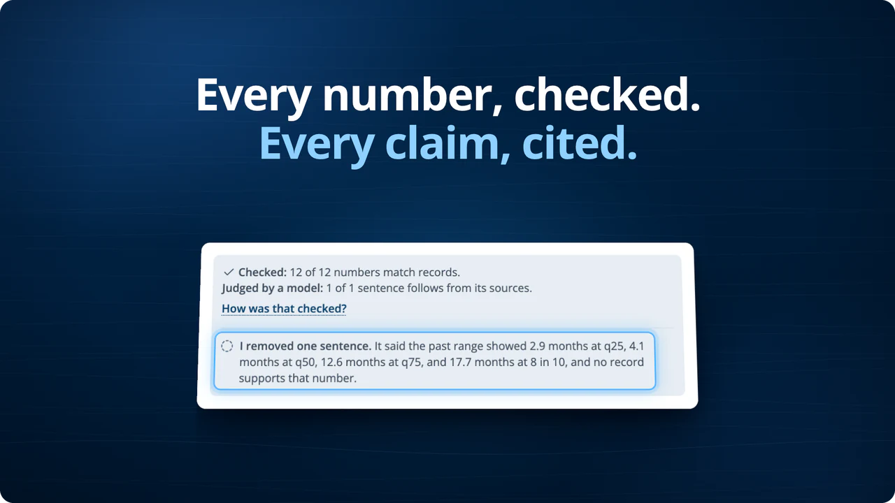
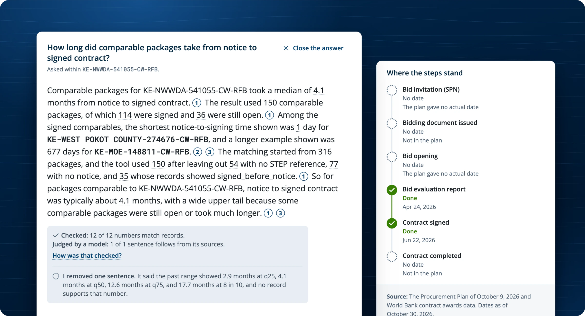
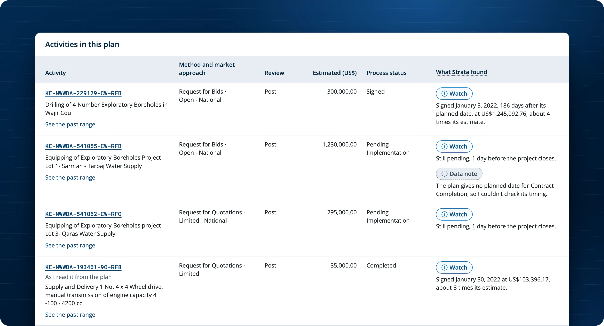
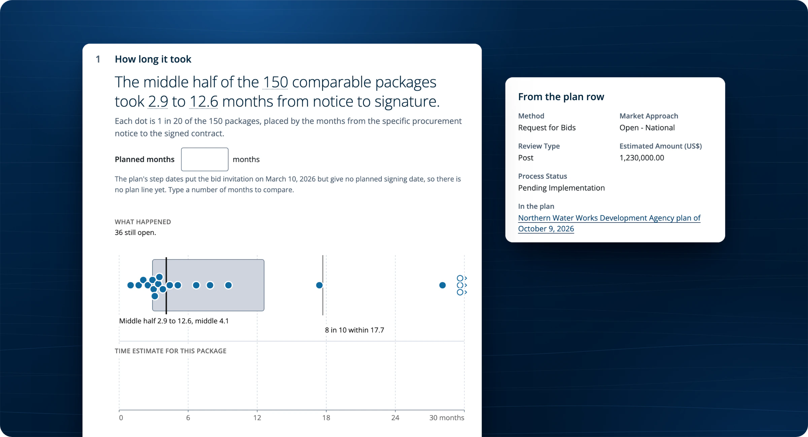
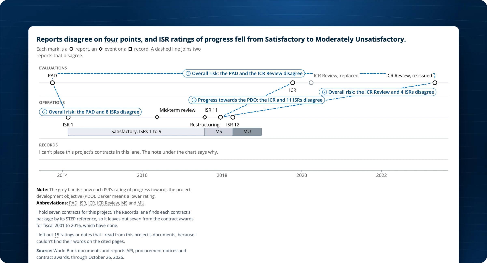
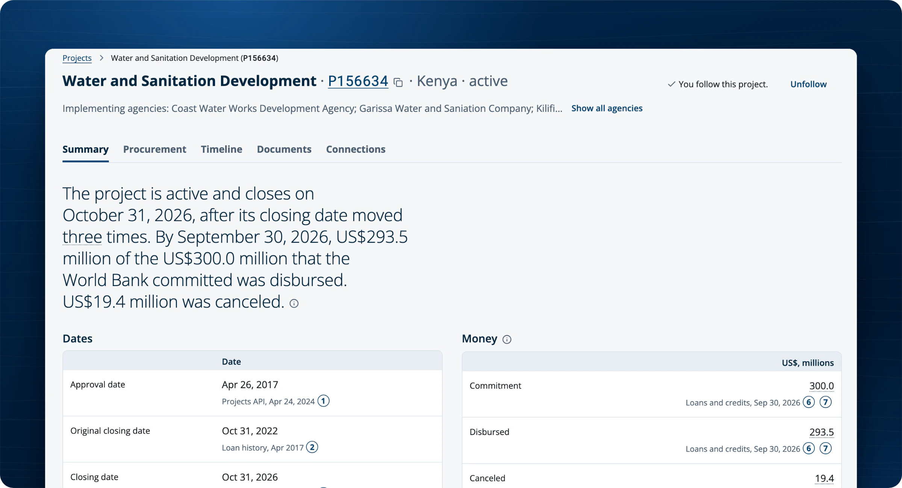
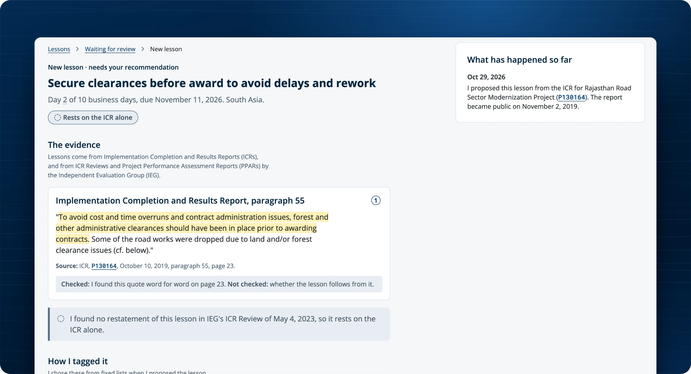
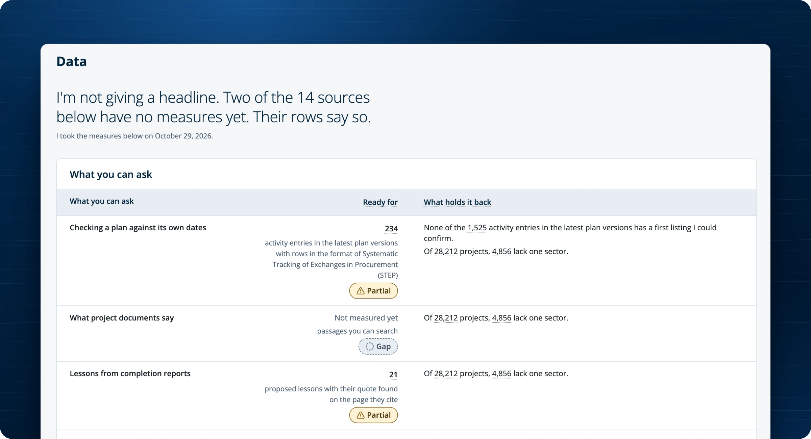
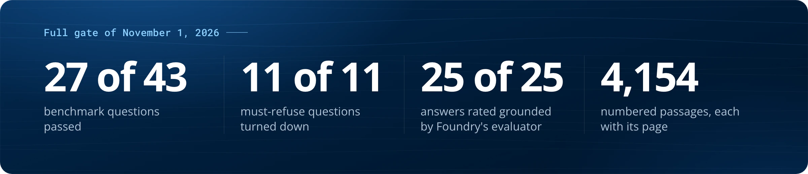
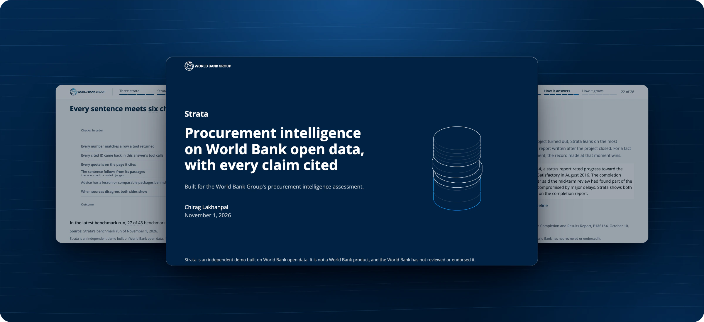

<h3 align="center">Strata is procurement intelligence on World Bank open data, with every claim cited.</h3>

Silent, 22 seconds, real screens from the live app. Select the film to open the full-quality MP4.

## Ask about any package

Ask a question in plain words. Strata answers from World Bank records and documents, and each sentence names its source. Before you see the answer, a verifier checks every number against the records. It removes any sentence it can't back and shows you why.

## Check a borrower's plan, row by row

Strata reads a borrower's Procurement Plan from its latest published version. It checks each activity against past ranges, review thresholds and the plan's own dates. A row marked Watch is a reason to look, never a finding, and it names the record behind it.

## See how long packages like this one took

Comparable packages give the past range, from each notice to its signed contract. Packages still open stay in the range, so it keeps the slow cases. A survival model gives the time estimate, and with no model or too few packages, Strata says why instead of guessing.

## See where reports disagree

Reports written before, during and after a project don't always agree. Strata puts each disagreement on one timeline and keeps both reports on screen. It says which one it leans on, and why.

## Read a project in a few sentences

Each project opens on a short summary of its dates, money and ratings. Every figure cites its record, and one click opens it.

## Lessons that people decide

Strata proposes lessons from completion reports and quotes each one word for word, with its page. An accredited procurement specialist recommends each lesson, and a different lead procurement specialist decides. Nothing enters the library until a lead decides.

## It says what it can't answer yet

The Data page shows what each kind of question is ready for and what holds it back. When a source has no measures yet, Strata says so instead of giving a headline.

## How it scored

These results come from the full gate of November 1, 2026. Each number is in [docs/proposal/snapshot.json](/docs/proposal/snapshot.json), with the run that measured it.

## How it's built

A nightly job turns World Bank open data and documents into one dated knowledge model on Databricks. The app runs every tool as the person asking. An agent in Microsoft Foundry picks the tools and writes the answer, and the verifier checks every sentence before anyone sees it.

## The presentation

The 28-slide deck covers the problem, a live demo, how Strata is built, how it answers and how it would grow.

**[Download the presentation (PDF, 28 slides, 1.4 MB)](/docs/presentation/strata-presentation.pdf)**

## Run it

The developer guide, [README.md](/README.md) at the root of the repo, covers installing, the gate, running the app on your computer and deploying it to a Databricks workspace.

Strata is an independent demo built on World Bank open data. It is not a World Bank product, and the World Bank has not reviewed or endorsed it. Built by Chirag Lakhanpal.
